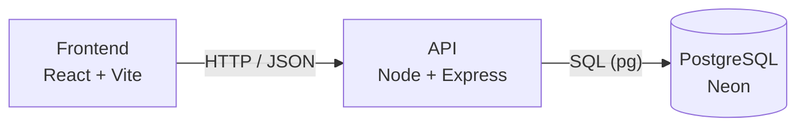
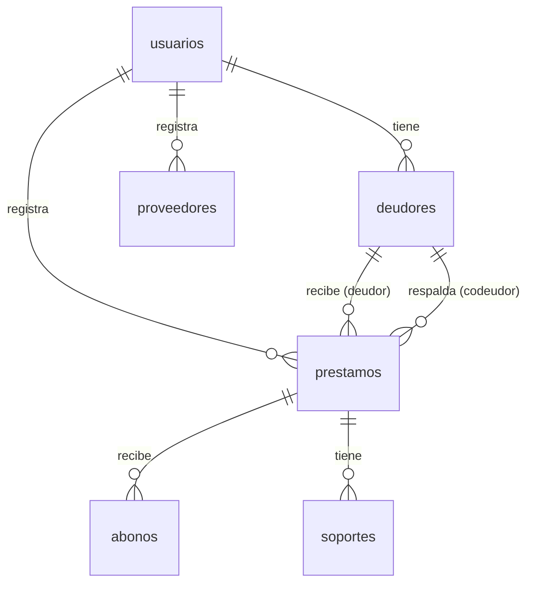

# JAY-wallet

Aplicación web para **prestamistas**: registra a quién le prestaste, cuánto, con qué interés, para cuándo vence y cuánto te han abonado, todo en un solo lugar.

> Proyecto Integrador I · Ingeniería de Sistemas · Universidad del Valle. Construido en equipo (3 personas).

---

## Tabla de contenido

1. [Descripción](#descripción)
2. [Funcionalidades](#funcionalidades)
3. [Stack tecnológico](#stack-tecnológico)
4. [Arquitectura](#arquitectura)
5. [Estructura del proyecto](#estructura-del-proyecto)
6. [Cómo empezar](#cómo-empezar)
7. [Variables de entorno](#variables-de-entorno)
8. [Base de datos](#base-de-datos)
9. [API (planificada)](#api-planificada)
10. [Flujo de trabajo en Git](#flujo-de-trabajo-en-git)
11. [Seguridad](#seguridad)
12. [Estado del proyecto](#estado-del-proyecto)
13. [Equipo](#equipo)

---

## Descripción

**El problema:** quien presta dinero suele llevar el control en la memoria, en notas sueltas o en chats, y con el tiempo se pierden datos: a quién se prestó, cuánto, cuándo vence y cuánto se ha pagado.

**La solución:** JAY-wallet centraliza esa información para poder consultarla en cualquier momento y cobrar a tiempo.

**Usuario:** un único tipo, el **prestamista** (persona natural, mayor de 20 años, que presta de forma habitual u ocasional). Los **deudores son datos** que él registra, no usuarios de la aplicación.

**Necesidades que cubre:**
1. Saber **quién debe, cuánto debe** y tener sus datos de contacto para cobrar a tiempo.
2. Acceder fácil a la información y llevar mejor control del dinero (capital prestado y ganancia).

## Funcionalidades

| Nivel | Qué incluye |
|---|---|
| **MVP** | Registro e inicio de sesión · deudores · préstamos · abonos · pantalla principal · estadística (lo que tengo prestado vs. lo que me deben) · historial |
| **Extras** | Proveedores (entidades que aportan capital) · soportes del préstamo (pagaré, comprobante) · exportar reportes · alertas de vencimiento |
| **Fuera de alcance** | Pagos reales · notificaciones por SMS o correo · app móvil nativa · varios tipos de usuario |

## Stack tecnológico

| Capa | Tecnología |
|---|---|
| **Frontend** | React + Vite (JavaScript, sin TypeScript) · ESLint |
| **Backend** | Node.js + Express (ES Modules) · `pg` · `dotenv` |
| **Base de datos** | PostgreSQL alojado en [Neon](https://neon.com) |
| **Autenticación** | JWT + bcrypt |
| **Despliegue (planeado)** | Frontend en Vercel o Netlify · Backend en Render · Base de datos en Neon |
| **Despliegue temporal (opcional)** | AWS con Docker y CDK (`deploy` antes de la sustentación, `destroy` después) |

## Arquitectura

Cliente-servidor con un **monolito por capas** y una **API REST**. Dos aplicaciones independientes que se comunican por HTTP:



El backend se organizará en capas, cada una con una sola responsabilidad:

```text
Ruta  >  Middleware  >  Controlador  >  Servicio  >  Acceso a datos
```

| Capa | Responsabilidad |
|---|---|
| **Ruta** | Define las URL del API (`/api/prestamos`) |
| **Middleware** | Verifica el JWT y valida los datos de entrada |
| **Controlador** | Recibe la petición y arma la respuesta |
| **Servicio** | Reglas de negocio (saldo, vencimientos, validación de abonos) |
| **Acceso a datos** | Consultas SQL parametrizadas a PostgreSQL |

## Estructura del proyecto

```text
JAY-wallet/
├── client/             # Frontend (React + Vite)
│   ├── src/
│   ├── public/
│   └── package.json
├── server/             # Backend (Node + Express)
│   ├── server.js
│   ├── package.json
│   └── .env.example
├── .gitignore
├── Objetives.md
└── README.md
```

> A medida que crezca el backend, `server/` se dividirá en `routes/`, `controllers/`, `services/`, `middleware/` y `db/`, siguiendo las capas descritas arriba.

## Cómo empezar

### Requisitos

- [Node.js](https://nodejs.org) (versión LTS) y npm
- [Git](https://git-scm.com)
- Una base de datos PostgreSQL. Para desarrollo, cada integrante crea la suya, gratis, en [Neon](https://neon.com) y ejecuta en el **SQL Editor** el archivo del esquema (ver [Base de datos](#base-de-datos)).

### 1. Clonar el repositorio

> Clónalo **fuera de OneDrive** (por ejemplo en `C:\dev`): sincronizar `node_modules` vuelve lento el equipo y puede dañar la carpeta `.git`.

```bash
git clone https://github.com/yilmar1212/JAY-wallet.git
cd JAY-wallet
```

### 2. Instalar dependencias

```bash
# Frontend
cd client
npm install

# Backend
cd ../server
npm install
```

### 3. Configurar las variables de entorno

En `server/`, copia el archivo de ejemplo:

```bash
# Linux / macOS / Git Bash
cp .env.example .env

# Windows (PowerShell)
Copy-Item .env.example .env
```

Abre `.env` y completa los valores (ver la siguiente sección). **Nunca subas `.env` a GitHub.**

### 4. Arrancar el proyecto

Necesitas dos terminales:

```bash
# Terminal 1 · Backend  ->  http://localhost:3000
cd server
npm run dev
# Prueba: http://localhost:3000/api/health
```

```bash
# Terminal 2 · Frontend  ->  http://localhost:5173
cd client
npm run dev
```

## Variables de entorno

Definidas en `server/.env` (la plantilla es `server/.env.example`):

| Variable | Descripción |
|---|---|
| `DATABASE_URL` | Cadena de conexión a PostgreSQL (Neon). Es una credencial: no se comparte por chat ni se sube al repo |
| `JWT_SECRET` | Clave secreta para firmar los tokens de sesión. Usa un valor largo y aleatorio |
| `PORT` | Puerto del servidor (por defecto `3000`) |

## Base de datos

PostgreSQL en Neon. El esquema contiene estas tablas y una vista:

| Tabla | Qué guarda |
|---|---|
| `usuarios` | Los prestamistas: nombre, correo y contraseña cifrada |
| `deudores` | Personas a quienes se presta: nombre, documento, teléfono, dirección, correo |
| `prestamos` | Monto, tasa de interés, fechas de inicio y vencimiento, estado |
| `abonos` | Pagos parciales o totales de un préstamo |
| `proveedores` | Entidades que aportan capital al prestamista |
| `soportes` | Archivos que respaldan un préstamo (se guarda la URL) |
| `v_prestamos_saldo` *(vista)* | Préstamos con total abonado, saldo pendiente y si están vencidos |



**Decisiones de diseño**

- El **saldo pendiente** y el estado **«vencido»** se calculan al consultar, no se guardan. Así se corrigen solos si se registra un abono por error. El estado guardado es solo `activo`, `pagado` o `anulado`.
- El dinero se guarda como `NUMERIC(14,2)`, nunca como `float`, para evitar errores de redondeo.
- El **codeudor** es otro registro de `deudores`.
- Todo dato tiene dueño (`usuario_id`): cada consulta filtra por el usuario autenticado.

**Pendiente por definir:** si la tasa de interés es mensual o anual, y si el interés es simple o compuesto.

> El archivo `schema.sql` con el esquema completo debe vivir en `server/db/`. Si aún no está en el repo, está en la lista de tareas pendientes.

## API (planificada)

| Método y ruta | Qué hace |
|---|---|
| `GET /api/health` | Comprueba que el servidor está vivo *(ya disponible)* |
| `POST /api/auth/registro` | Crea un usuario |
| `POST /api/auth/login` | Inicia sesión y devuelve el JWT |
| `GET` · `POST /api/deudores` | Lista o crea deudores |
| `GET` · `PUT /api/deudores/:id` | Ver o editar un deudor |
| `GET` · `POST /api/prestamos` | Lista (con filtros) o crea préstamos |
| `GET /api/prestamos/:id` | Detalle con saldo pendiente y abonos |
| `POST /api/prestamos/:id/abonos` | Registra un abono |
| `GET /api/estadisticas` | Totales: lo prestado vs. lo que me deben |
| `GET` · `POST /api/proveedores` | Lista o crea proveedores *(extra)* |

## Flujo de trabajo en Git

Flujo simple: una rama estable (`main`) y ramas por tarea (`feature/...`).

```bash
# 1. Parte de main actualizado
git checkout main
git pull origin main

# 2. Crea tu rama
git checkout -b feature/nombre-de-tu-tarea

# 3. Trabaja y guarda en commits pequeños
git add .
git commit -m "feat: descripción de lo que hiciste"

# 4. Sube la rama
git push -u origin feature/nombre-de-tu-tarea
```

5. Abre un **Pull Request** hacia `main` y pide revisión a otro integrante.
6. Úne el PR con **Squash and merge** y borra la rama.

**Acuerdos del equipo**

- Nadie trabaja directo en `main`: todo entra por Pull Request.
- Una rama por tarea, de vida corta (uno o dos días).
- Otro integrante revisa antes de unir.
- Se hace `git pull` en `main` antes de empezar cada tarea.

**Mensajes de commit**

| Prefijo | Cuándo |
|---|---|
| `feat:` | Algo nuevo que funciona |
| `fix:` | Arreglo de un error |
| `docs:` | Documentación |
| `refactor:` | Reorganizar sin cambiar el comportamiento |
| `chore:` | Configuración y dependencias |

Las tareas se gestionan en el tablero de **Notion** del equipo, organizadas en sprints de una semana.

## Seguridad

Este repositorio es **público**: cualquiera puede ver el código y el historial completo.

- Contraseñas, claves y cadenas de conexión viven **solo** en `server/.env`, que está en `.gitignore`.
- Si se sube un secreto por error, **borrar el commit no basta**: hay que cambiar esa clave de inmediato.
- Las contraseñas de usuario se guardan con **bcrypt**; nunca en texto plano.
- Las consultas SQL usan **parámetros**, nunca texto concatenado.
- Todo se valida también en el servidor, y las rutas privadas exigen un JWT válido.
- Solo se usan **datos ficticios** en pruebas, capturas y demos.

## Estado del proyecto

**Preparación (Sprint 0)**
- [x] Arquitectura de la información y wireframes
- [x] Diseño de la base de datos ejecutado en Neon
- [x] Repositorio creado (flujo con `main` y ramas `feature/...`)
- [x] Estructura inicial de carpetas (`client/` y `server/`)
- [x] Backend con Express y endpoint de prueba `/api/health`
- [ ] Agregar `schema.sql` al repo (`server/db/`)
- [ ] Conectar Express a Neon con `.env` y verificar la conexión

**Siguientes sprints**
- [ ] **Sprint 1:** login, registro y deudores
- [ ] **Sprint 2:** préstamos y abonos
- [ ] **Sprint 3:** pantalla principal, estadística e historial *(fin del MVP)*
- [ ] **Sprint 4:** proveedores, soportes, validaciones, datos de prueba y sustentación

## Equipo

| Nombre | GitHub |
|---|---|
| Yilmar | [@yilmar1212](https://github.com/yilmar1212) |
| *(completar)* | *(completar)* |
| *(completar)* | *(completar)* |

---

Proyecto académico con fines educativos.